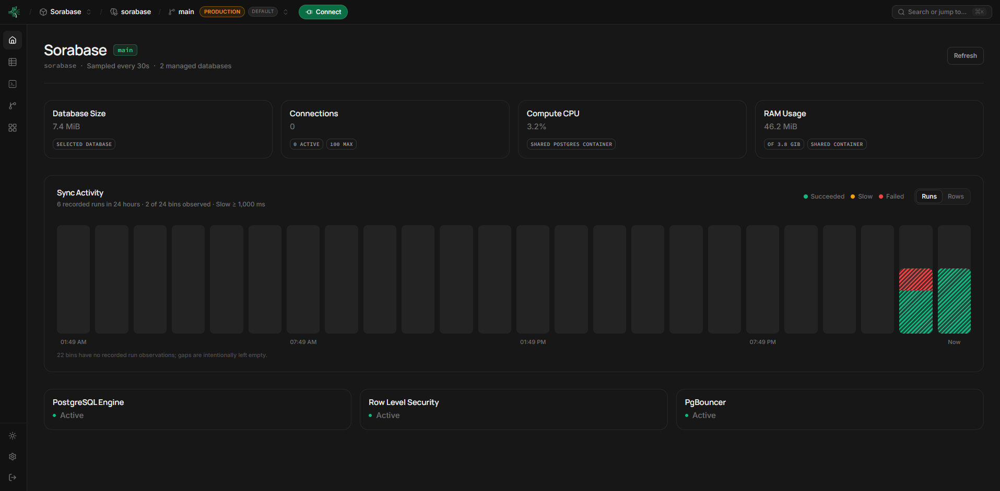
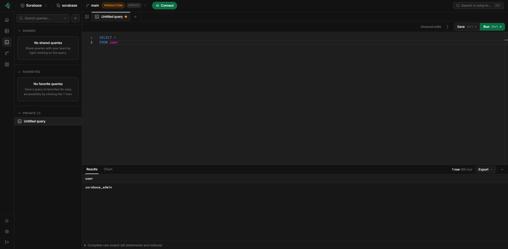
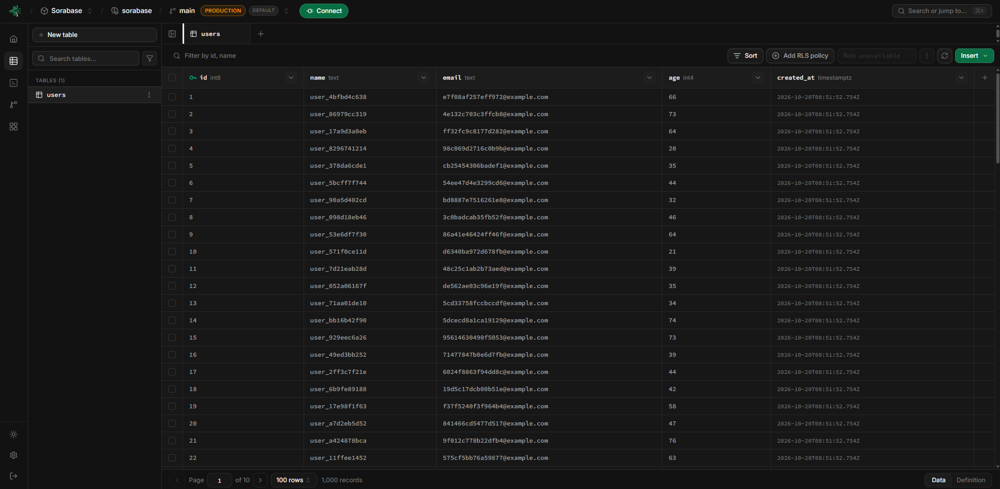
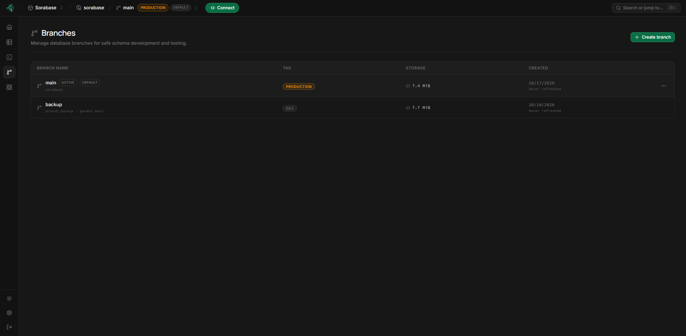
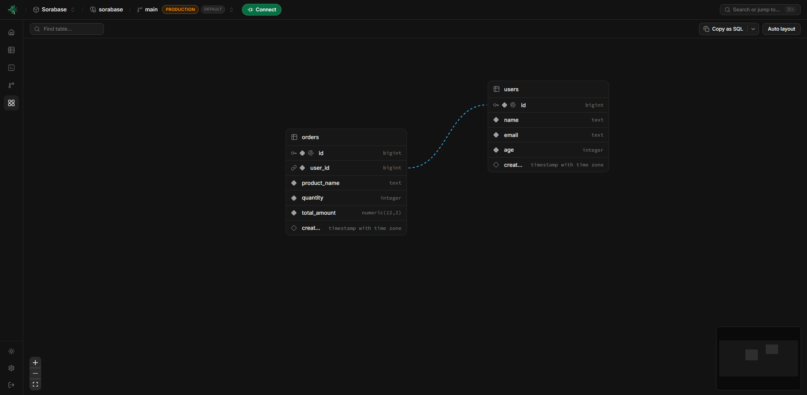
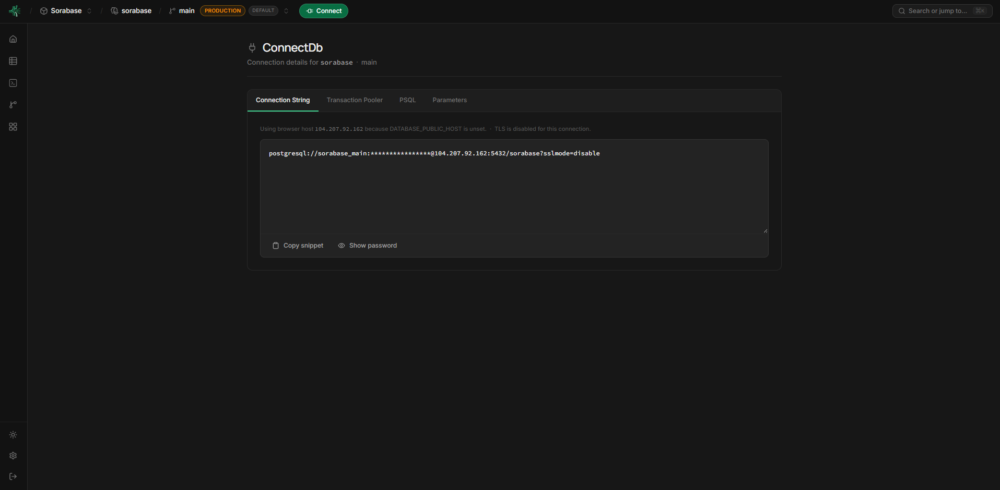
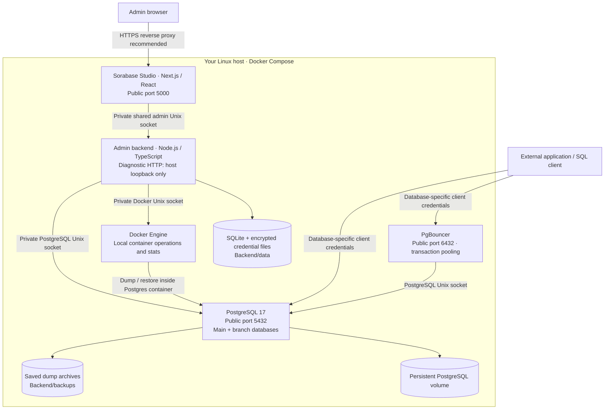

<div align="center">
  
  <h1>Sorabase</h1>
  <p><strong>Your PostgreSQL. Your infrastructure. One Studio.</strong></p>
  <p>A modern, self-hosted PostgreSQL management platform inspired by Supabase and Neon.</p>
  <p>
    <a href="#features">Features</a> ·
    <a href="#demo-screenshots">Screenshots</a> ·
    <a href="#infrastructure">Infrastructure</a> ·
    <a href="#installation">Installation</a> ·
    <a href="#security">Security</a> ·
    <a href="#contributing">Contributing</a>
  </p>
  <p>
    <a href="LICENSE"></a>
    
    
    
  </p>
</div>

---

## Introduction

Sorabase is a modern, self-hosted PostgreSQL management platform inspired by Supabase and Neon. It provides a powerful, developer-friendly environment to manage databases, explore tables, run SQL, create database branches, configure row-level security, and maintain backups from one web-based Studio.

Run the complete stack on your own Linux machine using Docker Compose. Your application data stays in PostgreSQL, while Studio metadata stays in a local SQLite database.

**Sorabase is an independent project, not affiliated with Supabase or Neon.** It is a PostgreSQL management platform—not a replacement for every service those platforms provide.

## Features

| Feature | What you can do |
| --- | --- |
| **Database dashboard** | Monitor database size, connections, activity, and Postgres-container CPU and RAM using real backend readings. |
| **Service status** | See live PostgreSQL Engine, Row Level Security, and PgBouncer status for your environment. |
| **Table Editor** | Browse records, search/filter rows, edit cells, insert and delete records, and manage table structure. |
| **SQL definitions** | Inspect read-only, highlighted table DDL with line numbers and open it as a draft in the SQL Editor. |
| **SQL Editor** | Execute SQL, inspect results and errors, and organize saved queries with folders, favorites, and Private/Shared groups. |
| **Result exports** | Copy query results as JSON, CSV, or Markdown, or download CSV. |
| **Database branches** | Create independent databases from main or another branch, edit tags, pull from a parent, and delete child branches. |
| **Schema Visualizer** | Explore tables and foreign-key relationships, and export the selected database's schema as SQL. |
| **Row-level security** | View and manage real PostgreSQL policies, target roles, commands, predicates, and RLS/FORCE settings. |
| **Backups and restore** | Create saved snapshots, restore them with confirmation, download snapshot SQL, and delete old backups. |
| **Client connections** | Get direct PostgreSQL or transaction-pooler connection details, with masked passwords and explicit copy/reveal controls. |
| **Database settings** | Reset a selected database's client password, terminate its client connections, or reset its contents with confirmation. |
| **PgBouncer controls** | Configure the shared pool size from main; the global client limit is fixed at 200. |
| **Admin sign-in** | Use an admin username or email and password, with server-managed HttpOnly sessions. |

### How branches work

Each branch is a separate database inside the **same PostgreSQL instance**, with its own client credentials. Branches isolate database contents, not compute resources.

- Create a branch from main or another branch.
- Use the Studio header selector to change the active database.
- Main's actions menu contains **Rename tag** only.
- Child branches expose **Edit tag**, **Pull / refresh**, and **Delete branch**.
- Only the selected branch-list row shows its actions button.
- Pulling replaces the child's contents with its parent's snapshot. It is **not a merge** and can disconnect target clients.

Branch creation uses PostgreSQL dump/restore operations; it is not storage-level copy-on-write or serverless branching.

## Demo screenshots

A look inside Sorabase Studio in dark mode. Click a screenshot to view it at full size.

### Dashboard

Database metrics, recorded activity, and PostgreSQL, RLS, and PgBouncer status in one view.

[](docs/screenshots/dashboard.png)

### SQL Editor

Write and run SQL, organize saved queries, and inspect query results.

[](docs/screenshots/sql-editor.png)

### Table Editor

Browse records, filter rows, edit data, and inspect table definitions.

[](docs/screenshots/table-editor.png)

### Database branches

Manage main and child databases with tags, storage details, and branch actions.

[](docs/screenshots/branches.png)

### Schema Visualizer

Explore tables and their foreign-key relationships on an interactive diagram.

[](docs/screenshots/schema-visualizer.png)

### Connect

Access connection strings, transaction-pooler details, and PSQL examples with passwords masked by default.

[](docs/screenshots/connect.png)

## Infrastructure

All services run on **one Docker host** and one Compose network. Browser traffic and external database-client traffic are separate from privileged admin operations.



### Technology stack

| Layer | Technology |
| --- | --- |
| Studio | Next.js 16, React 19, TypeScript, Tailwind CSS, Radix UI |
| SQL editing and diagrams | Monaco integration, React Flow, Dagre |
| Backend | Node.js 24+, TypeScript, Express, node-postgres, dockerode |
| Application databases | PostgreSQL 17 |
| Connection pooling | PgBouncer with wildcard database routing |
| Studio metadata | SQLite |
| Deployment | Docker Engine and Docker Compose v2 |

### Storage and persistence

| Location | Contents |
| --- | --- |
| `postgres-data` Docker volume | Main and branch database contents |
| `Backend/data/` | Admin account/settings, query library, branch/backup inventory, telemetry, and encrypted client-credential files |
| `Backend/backups/` | Saved PostgreSQL backup archives |
| `pooler-config` Docker volume | Persistent PgBouncer configuration |

Application rows stay in PostgreSQL. Client passwords are encrypted in private files, not stored in SQLite or browser storage. Preserve the encrypted files **and their `client-credentials.key` together** when backing up Studio metadata.

## Installation

### Requirements

- A Linux machine with local Docker Engine and **Docker Compose v2**.
- Docker available at `/var/run/docker.sock`.
- Git to clone the repository.
- Available ports: `5000` for Studio, `5432` for PostgreSQL, and `6432` for PgBouncer, unless customized.

No host Node.js, pnpm installation, manual schema push, or separate frontend/backend startup is required for Docker installation.

### 1. Clone the repository

```bash
git clone https://github.com/rehan3web/Astarbase.git
cd Astarbase
cp .env.example .env
```

The repository folder is named `Astarbase`; the application and default Docker resources are named **Sorabase**.

### 2. Configure your environment

Edit the root `.env` locally before starting the stack:

| Variable | Purpose |
| --- | --- |
| `DB_NAME` | Main database name; default example: `sorabase`. |
| `DB_USER` | Internal Unix-only admin role; default example: `sorabase_admin`. |
| `DB_PASSWORD` | Strong internal database password, at least 16 characters. |
| `ADMIN_API_TOKEN` | Private server-to-server secret, at least 32 characters. **Not a Studio login.** |
| `SESSION_SECRET` | Independent cookie-signing secret, at least 32 characters. Must differ from `ADMIN_API_TOKEN`. |
| `ADMIN_USERNAME` | First-run admin username, 3–48 characters using letters, numbers, `.`, `_`, or `-`. |
| `ADMIN_EMAIL` | Valid email address for the first-run admin account. |
| `ADMIN_PASSWORD` | First-run admin password, 12–256 characters. |

Generate a **different** random value for each secret, for example with `openssl rand -hex 32`. Never commit your `.env` or share its contents. Single-quote values containing `$` or `#`.

Optional settings:

| Variable | Default | Purpose |
| --- | --- | --- |
| `STUDIO_PORT` | `5000` | Public Studio port. |
| `POSTGRES_PUBLIC_PORT` | `5432` | Direct database-client port. |
| `PGBOUNCER_PUBLIC_PORT` | `6432` | Pooled database-client port. |
| `DATABASE_PUBLIC_HOST` | Browser hostname | Public DNS name/IP used in connection snippets. |
| `ADMIN_PORT` | `8000` | Host-loopback diagnostic API port; not a public API. |
| `STUDIO_COOKIE_SECURE` | `false` | Set `true` when Studio is served through HTTPS. |
| `SQL_TIMEOUT_MS` | `30000` | SQL execution timeout. |

See [`.env.example`](.env.example) for the complete configuration template.

### 3. Start Sorabase

```bash
docker compose up --build -d --wait
docker compose ps
```

Compose builds the services, starts PostgreSQL and PgBouncer, initializes Studio metadata, checks database access, and starts the frontend after backend healthchecks pass.

### 4. Open Studio

Visit **`http://YOUR_SERVER_IP:5000`**, or `http://127.0.0.1:5000` on the Docker host. Use your configured `STUDIO_PORT` if different.

Sign in with your **admin username or email and password**. There is no default password or public signup. Bootstrap account variables only create the first account; changing them later does not reset an existing login. After successful first-run setup, `ADMIN_PASSWORD` may be removed from `.env`.

> Before exposing Studio to the Internet, configure HTTPS and firewall rules. The default Compose database ports are publicly bound; restrict access to trusted client networks.

## Quick start

1. Open **SQL Editor**, select main, and run:

   ```sql
   CREATE TABLE public.notes (
     id bigint GENERATED BY DEFAULT AS IDENTITY PRIMARY KEY,
     title text NOT NULL,
     created_at timestamptz NOT NULL DEFAULT now()
   );

   INSERT INTO public.notes (title) VALUES ('Hello from Sorabase');
   SELECT * FROM public.notes;
   ```

2. Open **Table Editor** to browse and edit `notes`. Use **Definition** to inspect its SQL.
3. Create a `dev` branch and select it from the header. Changes there do not change main.
4. Open **Schema Visualizer** to inspect tables and relationships.
5. Open **Settings → Backups** to save a snapshot before destructive work.
6. Use **Connect** to obtain the active database's direct or pooled client credentials.

## Monitoring

- Database size, connections, and row/transaction activity come from PostgreSQL.
- CPU and RAM describe the **shared Postgres container**, not per-branch usage or the entire VPS.
- CPU usage can exceed 100% because 100% represents one CPU core.
- The backend samples managed databases every 30 seconds and retains telemetry for seven days.
- Activity charts use recorded events and observed row-counter changes, not generated sample data.
- RLS status is Active when at least one user table in the selected database has RLS enabled. It is not proof that every table is protected.

Unavailable readings are reported as unavailable rather than replaced with fabricated values.

## Backups and maintenance

Backups live under **Settings → Backups**. Saved custom-format PostgreSQL archives support restore and branch copying; downloadable `.sql` files are converted from the **saved snapshot**, not the current database.

Restore, pull/refresh, database reset, and deletion can replace or remove data. Read the confirmation carefully and create a backup first.

Useful host commands:

```bash
# Service status
docker compose ps

# Recent application logs
docker compose logs --tail=100 studio frontend

# Database and pooler logs
docker compose logs --tail=100 postgres pgbouncer

# Stop without removing persistent volumes
docker compose stop

# Restart existing services
docker compose start
```

### Updating

Back up your databases, `Backend/data/`, `Backend/backups/`, and your private environment configuration before upgrading.

```bash
git pull --ff-only origin main
docker compose up --build -d --wait
```

Keep your existing `.env`, bind-mounted directories, and Docker volumes. Rebuilding can interrupt connections.

**Do not use `docker compose down -v` unless you intend to delete persistent volumes.** Changing `DB_USER` or `DB_PASSWORD` in `.env` does not automatically rotate credentials inside an existing PostgreSQL volume.

### Forgotten internal database password

This is an explicit maintenance operation with downtime, not an automatic startup reset. It changes the configured internal `DB_USER` password without deleting application data.

Set the desired `DB_PASSWORD` in your private `.env`, then:

```bash
docker compose build studio
docker compose stop -t 60 frontend studio pgbouncer postgres
docker compose run --rm --no-deps studio \
  node dist/src/maintenance/reset-password.js --confirm-user sorabase_admin
# Continue only after the command reports "Password reset confirmed".
docker compose up -d --wait
```

Replace `sorabase_admin` with your configured `DB_USER`. If recovery fails, keep PostgreSQL stopped and inspect the error; do not delete lock files or volumes. This command does **not** reset the Studio admin account or an individual branch's client password.

## Security

- **Private admin transport:** Studio's server calls the backend over a shared Unix socket. Privileged database access uses PostgreSQL's Unix socket; container operations use Docker's Unix socket.
- **Separate client credentials:** Main and each branch have dedicated non-superuser client logins. The internal admin role is blocked on public PostgreSQL and PgBouncer connections.
- **Password-based Studio login:** Admin passwords are stored as salted scrypt hashes; sessions use signed HttpOnly cookies.
- **Sensitive operations:** Password reveal/copy and mutations require authenticated requests. Never expose the Docker socket or admin token publicly.
- **Deployment boundary:** Docker-socket access gives the backend powerful host capabilities. Run it only on a trusted machine.
- **HTTPS and network restrictions:** Use a trusted reverse proxy, set `STUDIO_COOKIE_SECURE=true` for HTTPS, and restrict Studio/database ports. Configure external database TLS as needed; do not assume default public connections are encrypted.

### RLS considerations

Studio's privileged internal login bypasses RLS. Test policy behavior using the selected database's **non-superuser client credentials**, not Studio's SQL Editor.

Enabling RLS without applicable policies denies ordinary client row access. Policies restrict access but do not grant schema/table privileges. Sorabase does not provision Supabase-style `auth.uid()` or an application-user authentication service.

## Development

For source development and tests, use **Node.js 24+** and **pnpm 10.26.1**.

```bash
pnpm install
pnpm build
pnpm test
```

Additional checks:

```bash
pnpm --filter sorabase-backend typecheck
pnpm --filter sorabase-backend test:integration
pnpm --filter studio typecheck
pnpm --filter studio test:integration
```

Integration checks need local PostgreSQL binaries; browser checks also need Chromium (`CHROMIUM_PATH` can override its location). Build before running browser integration tests. Their test-only Docker adapter does not verify production Docker images, PgBouncer startup, public ports, or firewall configuration.

For frontend development, `pnpm dev:studio` serves port 5000. A working backend Unix socket and private environment configuration are still required for live data.

### Project structure

```text
.
├── Frontend/             # Next.js Studio, UI components, browser tests
├── Backend/              # TypeScript admin API, services, maintenance tools
│   ├── data/             # Local metadata and encrypted credentials (runtime)
│   └── backups/          # PostgreSQL archives (runtime)
├── docker/               # PostgreSQL and PgBouncer startup configuration
├── docker-compose.yml    # Complete single-host stack
├── .env.example          # Environment template; no real secrets
├── package.json          # Workspace commands
└── LICENSE               # Apache License 2.0
```

## Troubleshooting

| Problem | What to check |
| --- | --- |
| A service does not become healthy | Run `docker compose ps` and inspect that service's logs. Check required `.env` values and port conflicts. |
| Studio reports missing admin setup | Confirm first-run account fields and distinct server secrets are configured. Existing accounts are not replaced on restart. |
| Backend is unavailable | Check `studio` health, the shared admin socket, Docker socket permissions, and PostgreSQL health. |
| PostgreSQL reports `28P01` | Verify credentials match the existing volume. Editing `.env` alone does not reset the stored password. |
| A public database client cannot sign in | Use the selected database's **Connect** snippet, not the internal admin credentials. Check host, port, and firewall rules. |
| RLS appears ineffective in Studio | Studio bypasses RLS; test with a non-superuser client and verify policies and privileges. |
| Metrics are unavailable | Check PostgreSQL access and Docker permissions. Fresh installations need actual sampling time to build history. |

## Contributing

Issues and pull requests are welcome at [rehan3web/Astarbase](https://github.com/rehan3web/Astarbase).

Before submitting a change:

1. Describe the problem and expected behavior.
2. Keep changes focused and add relevant tests.
3. Run the appropriate build and checks.
4. Never include `.env`, credentials, runtime database files, or backup archives.

For component-specific notes, see the [backend guide](Backend/README.md) and [frontend guide](Frontend/README.md).

## License

Sorabase is distributed under the [Apache License 2.0](LICENSE).
